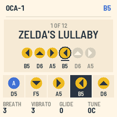

# OCA-1 for the M-VAVE FM-1

OCA-1 turns the M-VAVE FM-1 into an ocarina for games that listen. It plays one clear note at a time, close to a
pure tone, so the Nintendo Switch 2 version of Ocarina of Time hears your songs through the console's microphone.
The songbook has the game's twelve songs, written with the game's five buttons (D5, F5, A5, B5 and D6). The keys you
need light up in turn, PLAY plays a song for you, and OCA-1 names each song you finish.

For the controls, see the [manual](app/docs/MANUAL.md).

## Building

    git submodule update --init --recursive
    PYTHON=/opt/homebrew/bin/python3.14 ./build.sh     # app/build/oca.fwsc
    sh tests/run_tests.sh                              # the voice's pitch, the app in the simulator, the emulator, the words

The toolchain, the SDK and the build container are fm1-base's. For details, see base/README.md.

## Releasing

Releases are built, tested and signed on GitHub by `.github/workflows/release.yml` (the shared FM-1 builder,
zvenson/fm1-build@v1). Write the notes in a draft first, then push the tag:

    gh release create vX.Y --draft --title "OCA-1 X.Y" --notes "..."
    git push origin main vX.Y

Then publish the site from the attested package:

    gh release download vX.Y --pattern '*.fwsc' --dir app/build
    PYTHON=/opt/homebrew/bin/python3.14 tools/publish_pages.sh X.Y app/build/oca-X.Y.fwsc

## Licence

MPL-2.0. Built on [fm1-base](https://github.com/charlesvestal/fm1-base) and felucca-bsp, from
[Felucca](https://github.com/hugelton/Felucca) by Leo Kuroshita (Hügelton Instruments).

M-VAVE and FM-1 are trademarks of their owners. Nintendo Switch 2, The Legend of Zelda and Ocarina of Time are
trademarks of Nintendo. OCA-1 is not affiliated with M-VAVE or Nintendo.
