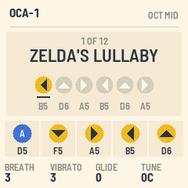
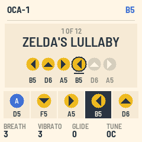
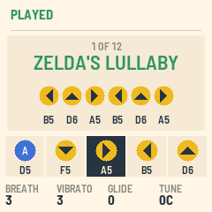
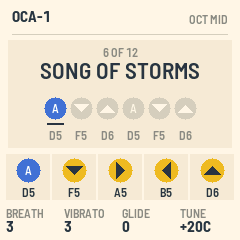

# OCA-1

OCA-1 turns your M-VAVE FM-1 into an ocarina. It plays one clear note at a time, close to a pure tone, so a game
that listens through a microphone can hear the notes you play. One such game is the Nintendo Switch 2 version of
Ocarina of Time, which listens for its songs through the console's microphone.

The songbook has the game's twelve songs, written with the game's five buttons. The keys you need light up in
turn, PLAY plays a song for you, and OCA-1 names any song you finish.

---

## Contents

1. Install
2. Playing a song to the game
3. The screen
4. Controls
5. Saving
6. MIDI and audio
7. The screen reader

---

## 1. Install

To try OCA-1 first, open the emulator. It runs the same code in your browser, with sound, and you can play it with
a mouse, a touch screen or the computer keyboard.

To install from the browser, connect the FM-1 by USB, open the installer in Chrome or Edge and press Install. The
browser asks once for permission to use MIDI, so allow it. Don't unplug the cable while it's writing.

To install from a terminal, run `python3 base/tools/fm1_install.py oca-VERSION.fwsc`.

To go back to M-VAVE's own firmware, use the last section of the installer.

---

## 2. Playing a song to the game

1. In the game, take out the ocarina and choose to play by sound.
2. Hold the FM-1 near the console, with the speaker toward it, and turn MASTER up.
3. Play the song on the lit keys, or press PLAY to have OCA-1 play it for you.

The game's five buttons are on five white keys in the middle of the keyboard:

| Button | Note | Key |
| --- | --- | --- |
| A | D5 | the D in the middle |
| Down | F5 | the F above it |
| Right | A5 | the A above that |
| Left | B5 | the B next to it |
| Up | D6 | the D at the top of the five |

These keys glow all the time. The next key of the song in the songbook blinks.

If the game misses notes, hold each one a little longer or bring the FM-1 closer. You can also turn KNOB 1
(BREATH) down for a purer tone. Turn KNOB 4 (TUNE) to move every note up to 50 cents sharp or flat.

---

## 3. The screen

| Part | What it shows |
| --- | --- |
| Header | Shows OCA-1 and the octave, or the note that's sounding. After you change something, a message shows here for a moment. |
| Songbook card | Shows the song's place in the book, its name and its buttons, with each button's note below it. The buttons you've played so far are in color, and the next one is underlined. |
| Five notes | Shows the game's buttons and their notes. The note that's sounding is dark. |
| Knobs | Show BREATH, VIBRATO, GLIDE and TUNE. |

When the last notes you played make up one of the twelve songs, the header says PLAYED and the song's card turns
green. This works for any of the twelve, whichever song the songbook is showing.

---

## 4. Controls

| Control | What it does |
| --- | --- |
| Keys | Play the ocarina, one note at a time. The newest key sounds. Let go of it, and the key you held before it sounds again. |
| PRESETS or SELECT | Turn the songbook's pages. |
| PLAY | Plays the song in the songbook. Press it again to stop. |
| OCT− · OCT+ | Set the octave to low, middle or high. The game's notes are in the middle octave. |
| KNOB 1 · BREATH | Sets how much air is in the tone, from 0 to 10. |
| KNOB 2 · VIBRATO | Sets the vibrato on a held note, from 0 to 10. |
| KNOB 3 · GLIDE | Sets how much one note slides into the next while you still hold a key, from 0 to 10. |
| KNOB 4 · TUNE | Sets the tuning, from 50 cents flat to 50 cents sharp. |
| MASTER | Sets the volume. |
| SAVE | Saves the settings. SAVE is lit while there are changes to save. |

---

## 5. Saving

Press SAVE to keep the octave, the songbook's page and the four knobs. They come back the next time you switch on
the FM-1.

---

## 6. MIDI and audio

The keys send their notes over USB on channel 1. You can also play the ocarina with notes from USB or the TRS
input.

Over USB, the FM-1 is also an audio device. Your computer can record OCA-1 and play its own sound through the FM-1.

---

## 7. The screen reader

OCA-1 tells the [FM-1 Screen Reader](https://charlesvestal.github.io/fm1-reader/) what its screen shows. The
reader says each song's buttons, names each song you play, and reads the knobs as you turn them.
